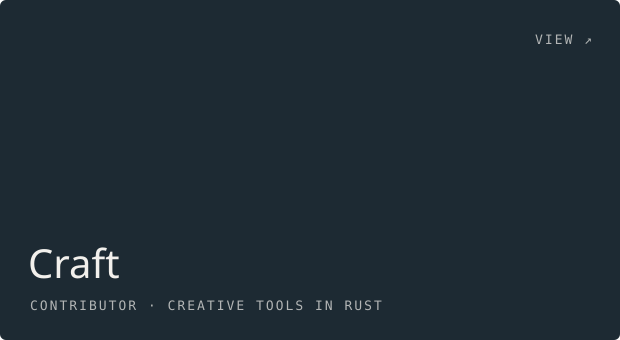

Art director who builds things in the evenings. Tools for creative work, given away.

<table>
<tr>
<td width="50%"></td>
<td width="50%"></td>
</tr>
<tr>
<td width="50%"></td>
<td width="50%"></td>
</tr>
</table>

RUST · TYPESCRIPT · PYTHON · COMFYUI · THREE.JS · BLENDER

<a href="https://jeremywalderwillows.co.uk">JEREMYWALDERWILLOWS.CO.UK ↗</a> &nbsp; <a href="https://instagram.com/jeremyjfww">INSTAGRAM ↗</a>
