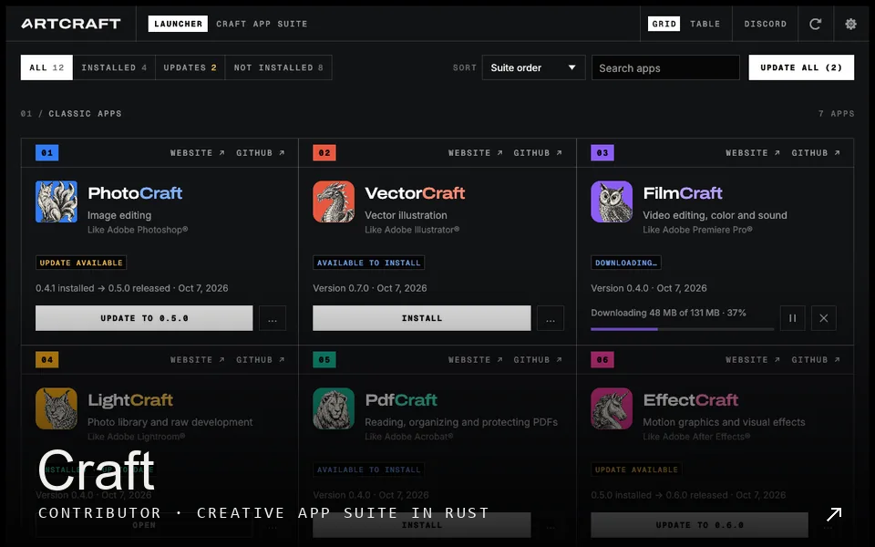
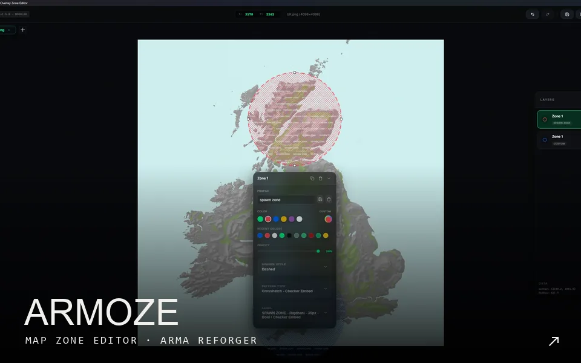
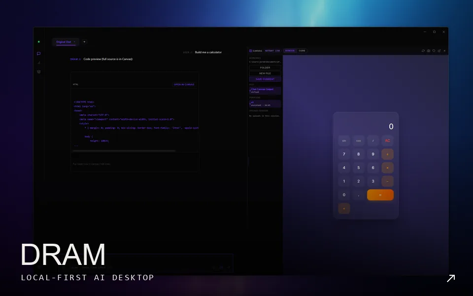
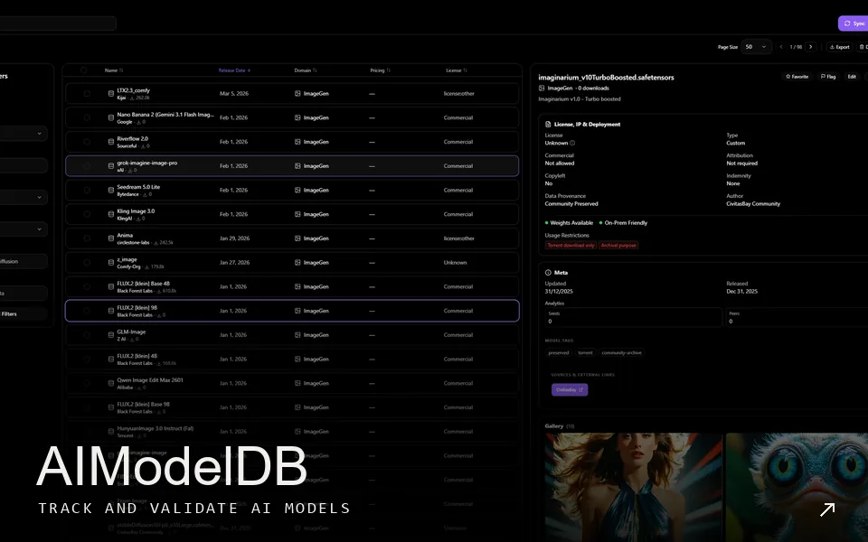

<a href="https://jeremywalderwillows.co.uk/?theme=reel#about">01 ABOUT ↗</a> &nbsp; <a href="https://jeremywalderwillows.co.uk/work/details/pandora-celebration-collection--mmwknucq?theme=reel">02 PANDORA ↗</a> &nbsp; <a href="https://jeremywalderwillows.co.uk/work/details/lu-synthetic-character-consistency-study--mps9frub?theme=reel">03 LU ↗</a> &nbsp; <a href="https://jeremywalderwillows.co.uk/work/details/white-label-sports-imagery--mmxft4tq?theme=reel">04 SPORTS ↗</a>

Art director who builds things in the evenings. Tools for creative work, given away.

<!-- Live card from streak-stats.demolab.com (external service, updates on its own). -->

<a href="https://jeremywalderwillows.co.uk">JEREMYWALDERWILLOWS.CO.UK ↗</a> &nbsp; <a href="https://instagram.com/jeremyjfww">INSTAGRAM ↗</a>
